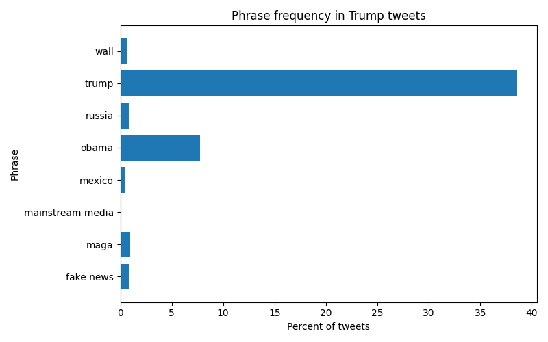

# [lab-web-data](https://csci40.rtealwitter.com/topics/05_web_scraping/lab.html)

|           phrase | percent of tweets |
| ---------------- | ----------------- |
|        fake news | 00.88             |
|             maga | 00.93             |
| mainstream media | 00.03             |
|           mexico | 00.45             |
|            obama | 07.73             |
|           russia | 00.91             |
|            trump | 38.58             |
|             wall | 00.68             |

"Trump" shows up in 38.58% of tweets and "Obama" in 7.73%, while my three picks are all under 1%, I expected "wall" to be the most common of my picks, but "maga" beat it.